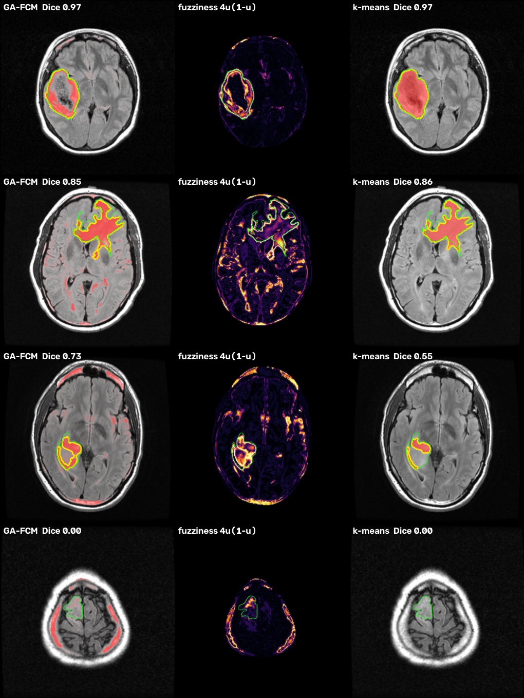

# Brain MRI Tumour Segmentation with GA-Initialised Fuzzy C-Means

Unsupervised **brain tumour segmentation on FLAIR MRI** using **Fuzzy C-Means** started from a **genetic algorithm**, both written from scratch in NumPy. No training data is needed. On top of the mask, it produces a **fuzziness heatmap** that points to the pixels where the segmentation is most likely to be wrong.




**Topics:** fuzzy sets and membership functions, fuzzy clustering, genetic algorithms.

> Research and teaching project only. It is not a medical device and must not be used for diagnosis.

## Problem

Tumour boundaries on MRI are blurry. A pixel at the edge of a glioma is often not clearly "tumour" or "not tumour", so a crisp yes/no label throws that information away. **Fuzzy C-Means (FCM)** keeps it: every pixel gets a **membership degree** in every tissue class, adding up to 1.

## Approach

```
FLAIR slice ─► skull stripping ─► features per brain pixel (intensity, 5×5 local mean)
                                        │
          ┌─────────────────────────────┼──────────────────────────────┐
     GA picks start centres      random start centres           random start centres
          │                             │                              │
         FCM                           FCM                          k-means (crisp)
          └──────────── tumour = brightest cluster (FLAIR hyperintensity) ─┘
                         same post-processing for all ─► mask + Dice vs expert
```

Everything is written from scratch in NumPy:

| File | What it is |
|---|---|
| [fcm.py](fcm.py) | Fuzzy C-Means (Bezdek): alternating membership/centre updates, objective J_m, partition entropy, partition coefficient |
| [ga.py](ga.py) | Real-coded GA: tournament selection, BLX-α crossover, Gaussian mutation, elitism. **Fitness** = the Hathaway–Bezdek reformulated FCM objective R_m(V), i.e. the FCM cost you'd get from those centres |
| [kmeans.py](kmeans.py) | Crisp k-means baseline |
| [pipeline.py](pipeline.py) | Skull stripping (radial intensity profile: scalp → dark bone → brain), features, post-processing, Dice, visualisations |
| [evaluate.py](evaluate.py) | All experiments below |
| [app.py](app.py) | Gradio web demo |

**Fuzziness heatmap:** `4·u·(1−u)`, where u is a pixel's tumour membership. It is 0 when the pixel is clearly tumour (u = 1) or clearly not (u = 0), and 1 when FCM is split 50/50. k-means cannot produce this map at all.

## Data

The **LGG brain-MRI segmentation dataset** (Buda et al., 2019; the Kaggle "lgg-mri-segmentation" set) contains TCGA lower-grade glioma patients with expert FLAIR abnormality masks. `download_data.py` fetches **20 patients (780 slices, ~200 MB)** from a public Hugging Face mirror, so no Kaggle login is needed.

To keep the evaluation honest, the **first 5 patients were used only for tuning**: choosing c = 5 clusters (Dice: c=3 0.52, c=4 0.60, **c=5 0.65**, c=6 0.61). **All results below come from the other 15 patients**: 180 slices with a tumour of at least 100 px.

## Results (`python evaluate.py`)

| | GA-FCM | FCM (random init) | k-means |
|---|---|---|---|
| Mean Dice vs expert | **0.603** | **0.603** | 0.592 |
| Median Dice | 0.677 | 0.677 | 0.690 |
| Mean IoU | 0.488 | 0.489 | 0.481 |
| FCM / k-means iterations | **48** | 63 | 45 |
| Time per slice | 0.63 s | 0.20 s | 0.10 s |
| Dice spread across 10 random restarts | **0.009** | **0.009** | 0.026 (3× larger) |
| Runs ending in a worse local optimum | 0.7% | 0.7% | **5.0%** |

### What the experiments show

**1. Fuzzy beats crisp on stability.** Clustering the same slice from different random starts, k-means ends in a worse optimum 7× more often than FCM, and its Dice varies 3× more. A concrete case is example slice `TCGA_DU_7304_19930325_19`: across 10 random starts, k-means scores 0.86 eight times and **0.00 twice**, while FCM scores 0.85 every time. Soft memberships smooth the cost landscape, so FCM is far less sensitive to its starting point.

**2. The fuzziness heatmap tells you where to distrust the result.**
- Wrongly labelled pixels have a mean fuzziness of **0.43**; correctly labelled pixels have **0.10**.
- **41% of all segmentation errors** fall in the pixels marked as fuzzy (> 0.5), which make up only **8% of the brain**. That is a 5× concentration.

A crisp method gives no such warning. This is the main practical argument for fuzzy over crisp: a radiologist could check only the highlighted 8%.

**3. The GA: an honest finding.**
- GA initialisation starts FCM almost at its optimum, cutting FCM iterations by **24%** (63 → 48). It never ended in a worse optimum in any test.
- On this data, however, **random-init FCM almost never gets stuck either** (0.7% of runs). Final Dice is identical, and the GA's own cost (≈1,200 fitness evaluations) makes GA-FCM slower overall.
- I also tested textbook FCM initialisation (a random membership matrix) and harder problems with 7 clusters. Bad optima stayed at or below 0.8% in every setting.
- **Conclusion:** with low-dimensional intensity features, the FCM cost landscape is benign. The GA acts as insurance and gives faster convergence, not higher accuracy. The GA would matter more with higher-dimensional features (e.g. multi-sequence MRI) and many clusters.
### Limitations

- **Intensity-only clustering assumes the tumour is the brightest tissue on FLAIR.** 20 of the 180 slices score Dice ≈ 0: dark cystic or resected tumours, and tumours no brighter than surrounding tissue (example 6 in the app).
- **It is a segmenter, not a detector.** On tumour-free slices it still outlines the brightest blob 77–80% of the time. In practice it would run after a classifier, or on slices a radiologist has flagged.
- Skull stripping is a simple rule, not a trained model. Slices near the eyes or the top of the skull are the hardest.

For reference, deep U-Nets reach Dice ≈ 0.82 on this dataset (Buda et al.), using thousands of labelled training slices. FCM needs **no training data at all**.

## Setup

Requires **Python 3.11**.

```bash
git clone https://github.com/Yuvrajys2512/brain-mri-ga-fcm.git
cd brain-mri-ga-fcm

python -m venv .venv
# Windows
.venv\Scripts\activate
# macOS / Linux
source .venv/bin/activate

pip install -r requirements.txt
python download_data.py      # 20 patients (~200 MB); --patients 40 for more
```

The dataset is not stored in this repository. The six example slices in `examples/` are enough to try the web demo without downloading anything.

## Running

```bash
python app.py         # web demo at http://127.0.0.1:7860 (on Windows you can also double-click run_demo.bat)
python evaluate.py    # all experiments (~25 min), writes results/; needs the downloaded dataset
```

## Demo walkthrough

1. Start `app.py`. The browser opens on the demo page.
2. Click **example 1** (a clear tumour), then **Segment**. Point out:
   - **Top left:** the tumour membership shown as red intensity, the crisp boundary in yellow, and the expert's outline in green.
   - **Top right, fuzziness heatmap:** bright only along the tumour edge and the uncertain parts. "This is what crisp methods can't tell you."
   - **Bottom right:** k-means gives a hard blob with no notion of uncertainty.
3. Example 4: the heatmap lights up exactly the region the crisp mask missed (inside the green outline).
4. Example 2: change the seed to 7 or 8 and press Segment again. k-means collapses to Dice 0, while FCM stays at 0.85.
5. Scroll down to the **GA plot**: fitness falls over the generations, and FCM started from the GA begins near the optimum and converges sooner than the random starts.
6. The **membership gallery** shows one map per tissue class, i.e. the fuzzy partition itself.
7. Example 6 (failure): be upfront about what intensity clustering can't do.
8. Optional: upload any brain MRI slice (PNG/JPG/TIF). The expert mask is only needed for the Dice score.

## Figures (`results/`)

- `examples.png`: overlay, fuzziness heatmap and k-means for 4 held-out slices
- `dice_comparison.png`: Dice box plot, restart stability, and fuzziness of correct vs wrong pixels
- `evaluation.json`, `per_slice_dice.json`: all the numbers

## References

- M. Buda, A. Saha, M. A. Mazurowski, "Association of genomic subtypes of lower-grade gliomas with shape features automatically extracted by a deep learning algorithm", *Computers in Biology and Medicine*, 2019.
- J. C. Bezdek, *Pattern Recognition with Fuzzy Objective Function Algorithms*, Plenum Press, 1981.
- R. J. Hathaway, J. C. Bezdek, "Optimization of clustering criteria by reformulation", *IEEE Transactions on Fuzzy Systems*, 1995.

## License

Code: [MIT](LICENSE). The example MRI slices in `examples/` come from the TCGA LGG collection (via Buda et al.) and remain under their original terms.
